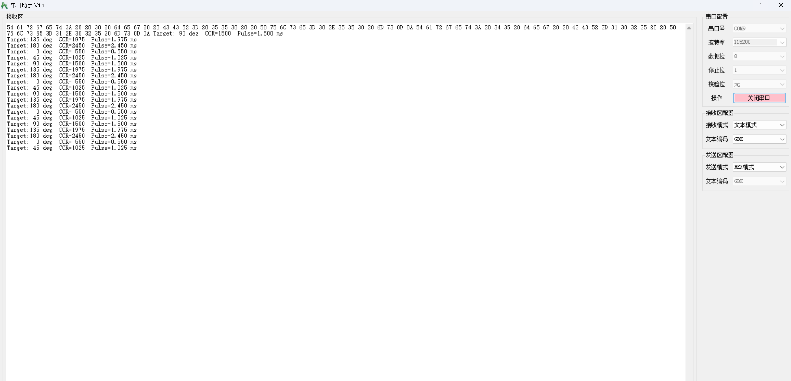

# STM32F103 舵机 + OLED + 串口

电控组第四次培训作业。王康悦 20263008220

用 STM32F103C8T6 输出 50Hz PWM 控制 SG90 舵机，在 0° / 45° / 90° / 135° / 180° 之间循环转动；OLED 显示当前角度、CCR 和脉宽；串口每秒打印一行。另外接了两个按键，可以手动加减角度。

硬件：Blue Pill（STM32F103C8T6）+ SG90 + 0.96 寸 SSD1306 OLED（4 针 IIC）+ CH340。

## 功能

| 功能 | 怎么做 | 现象 |
|---|---|---|
| 舵机转动 | TIM2_CH1 PWM，PSC=71，ARR=19999 | 五个角度循环，每步 1 秒 |
| 板载灯闪烁 | TIM3 1ms 中断，PSC=71，ARR=999 | 每 500ms 翻转一次 PC13 |
| OLED 显示 | 软件 IIC，PB1=SCL，PB0=SDA | 三行：角度 / CCR / 脉宽 |
| 串口打印 | USART1，115200 8N1，PA9=TX，PA10=RX | 每秒一行 Target / CCR / Pulse |
| 按键调角度 | PA12 加 15°，PA11 减 15° | 按下后切手动模式，限幅 0~180° |

## 定时器参数怎么算的

时钟：HSE 8MHz 经 PLL ×9 得到 72MHz。APB1 分频是 2，所以 PCLK1 = 36MHz；但 APB1 的分频系数不为 1 时，定时器时钟要乘 2，所以 TIM2 / TIM3 实际都跑在 72MHz。

TIM2 要做 50Hz PWM：

```
72MHz / (71+1) = 1MHz      1 个计数 = 1µs
(19999+1) / 1MHz = 20ms    周期 20ms，也就是 50Hz
```

这样 CCR 填多少，脉宽就是多少微秒，不用再换算。

TIM3 要做 1ms 中断：

```
72MHz / (71+1) = 1MHz
(999+1) / 1MHz = 1ms
```

中断里累加计数，到 500 次翻转一次 PC13，就是 500ms 亮、500ms 灭。

## 角度和 CCR 的对应

```c
CCR = 550 + angle / 180.0f * (2450 - 550)
```

| 角度 | CCR | 脉宽 |
|---|---|---|
| 0° | 550 | 0.550 ms |
| 45° | 1025 | 1.025 ms |
| 90° | 1500 | 1.500 ms |
| 135° | 1975 | 1.975 ms |
| 180° | 2450 | 2.450 ms |

没有用 500 / 2500，是因为舵机两端有机械限位，脉宽给到极限会顶住，一直堵转、发出咔咔声还发热。两头各留 50µs（大约 4.5°）之后，实际行程约 171°，不会顶到限位。

## 接线

舵机（必须独立供电，不能从板子上取）：

| SG90 | 接到 |
|---|---|
| 信号（橙/黄） | PA0 |
| VCC（红） | 独立 5V（12V 电池 + 降压模块），电流要够 1A |
| GND（棕/黑） | 降压模块 GND，并且要和开发板 GND 连在一起 |

OLED：

| OLED | 接到 |
|---|---|
| GND | GND |
| VCC | 5V |
| SCL | PB1 |
| SDA | PB0 |

USB-TTL：

| CH340 | 接到 |
|---|---|
| TXD | PA10 |
| RXD | PA9 |
| GND | GND |
| VCC | 不接（板子已经由 ST-Link 供电） |

按键（一脚接引脚，对角那脚接 GND，不用外接电阻，代码里开了内部上拉）：

| 按键 | 接 |
|---|---|
| 加 15° | PA12 — GND |
| 减 15° | PA11 — GND |

PA11 和 PA12 是 USB 的 D− / D+，这个工程不用 USB，所以能当普通 IO 用。但板子上的 USB 口不能插线，一插这两个脚就被占了，按键会失灵。

上电后：先摆到 90°，然后每秒走一步五角度循环。按任意一个键就切到手动模式，之后只听按键的；想回到自动循环，按一下 RESET。

## 编译和烧录

```bash
# 编译
cmake --build build/Debug

# 烧录
openocd -f E:/Clion/CFJ_STM32/stm32f1.cfg \
        -c "program build/Debug/servo_lab.elf verify reset exit"
```

看到 `Verified OK` 就是烧进去了。注意烧录不会自动编译，改完代码要先编译再烧，否则烧进去的还是上一次的程序。

## 串口输出

串口助手设 COM9 / 115200 / 8 / 1 / 无，接收模式选文本模式。



```
Target:  0 deg  CCR= 550  Pulse=0.550 ms
Target: 45 deg  CCR=1025  Pulse=1.025 ms
Target: 90 deg  CCR=1500  Pulse=1.500 ms
Target:135 deg  CCR=1975  Pulse=1.975 ms
Target:180 deg  CCR=2450  Pulse=2.450 ms
```

## 遇到的问题

- **OLED 完全不亮**：最后查出来是接线和供电。面包板的电源轨是一排簧片，离电源入口越远接触电阻越大，OLED 一启动就被拉低电压，屏幕黑掉或者亮一下就灭。改成从板子针脚直接拉线之后正常。另外 OLED 接 5V 比 3.3V 稳。
- **软件 IIC 太快**：原来的写法拉高 SCL 之后马上拉低，高电平只有 0.2µs 左右，SSD1306 要求至少 0.6µs，会收错数据。加了位延时才行。
- **屏幕亮一下就黑，但板载灯还在闪、舵机还在动**：说明单片机没死，是 OLED 模块自己掉电了。OLED 的显示内容是模块自己存的，一断电就清空。
- **烧了没反应**：有一次是改了代码没编译就烧，还有一次是烧录脚本的路径写错了（`E://OpenOCD//bin` 这种双斜杠），实际根本没烧进去。看 `Verified OK` 才作数。
- **工程名不能带小数点**：之前叫 `11.16`，CLion 会当成文件名 11 加扩展名 .16，报"未指定可执行文件"。
- **链接报 `.ARM.extab` 错误**：CubeMX 生成的 `.ld` 文件里有 5 处 `(READONLY)`，GCC 10.3.1 不支持，删掉就好，但每次重新生成代码都会回来。

## 目录

```
Core/Inc    Servo.h  OLED.h  OLED_Font.h  main.h  tim.h ...
Core/Src    main.c  Servo.c  OLED.c  tim.c  gpio.c  usart.c ...
Drivers/    HAL 库和 CMSIS
docs/       串口截图
servo_lab.ioc   CubeMX 工程
CMakeLists.txt
```
